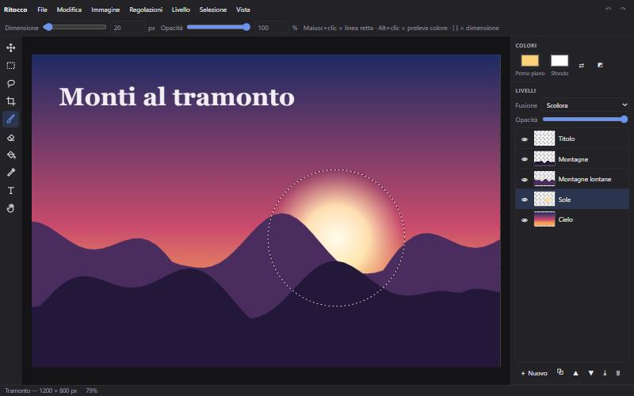

<h1 align="center">REbuild 🔁</h1>

<p align="center">
  <strong>Non pagare l'abbonamento: fatti costruire da Claude la tua versione gratuita.</strong><br>
  Una skill per Claude che ricrea da zero le funzioni principali dei programmi a pagamento,<br>
  come app che si aprono con un doppio clic.
</p>

<p align="center">
  <a href="https://ascaniolocorotondo.github.io/rebuild/"></a>
  <a href="https://ascaniolocorotondo.github.io/rebuild/demo/ritocco.html"></a>
  <a href="#installazione"></a>
  <a href="LICENSE"></a>
</p>

<p align="center">
  <a href="https://ascaniolocorotondo.github.io/rebuild/demo/ritocco.html">
    
  </a><br>
  <sub><em>Ritocco</em>, un editor di immagini costruito con REbuild: <a href="https://ascaniolocorotondo.github.io/rebuild/demo/ritocco.html">provalo nel browser</a>.</sub>
</p>

<p align="center"><a href="#-english">🇬🇧 English below</a></p>

---

## Cosa fa

Scrivi a Claude una frase come:

> «Fammi una versione gratis di Trello»
> «Mi serve un Photoshop solo per ritagliare e scontornare»
> «Non voglio più pagare YNAB, creamelo tu»

e REbuild:

1. **sceglie le funzioni che usi davvero**, partendo da un catalogo di oltre 40 programmi;
2. **costruisce** una versione completa e funzionante;
3. **la prova** prima di consegnartela;
4. ti dà **un file che apri con doppio clic**: una web app in un solo file HTML, che funziona offline e salva i dati nel browser, oppure un'app Python per Windows quando serve accedere ai file del PC.

Niente account, niente abbonamenti, niente pubblicità. Il programma è tuo.

## Cosa può ricostruire

| Categoria | Esempi |
|---|---|
| 🎨 Grafica e foto | Photoshop, Lightroom, Canva, Remove.bg, TinyPNG |
| ✏️ Design | Illustrator, Figma, Procreate |
| 📄 Ufficio | Word, Excel, PowerPoint, Acrobat (PDF), Grammarly |
| ✅ Produttività | Notion, Trello, Todoist, Evernote/Obsidian, Calendar, Toggl, Pomodoro |
| 💶 Finanze | YNAB, fatturazione |
| 🎵 Musica | FL Studio / Ableton, Audacity, accordatore e metronomo, lettore musicale |
| 🎬 Video | Premiere / CapCut, OBS, HandBrake |
| 🛠️ Strumenti tecnici | Postman, editor di database, diagrammi |
| 💻 Sistema e file | WinRAR, CCleaner, rinominatore in blocco, password manager |
| 📚 Studio | Anki / Quizlet, Kahoot, esercizi tipo Duolingo |
| 📐 3D e CAD | SketchUp / Tinkercad, AutoCAD 2D |
| 📣 Marketing | Mailchimp, Hootsuite, Typeform |

Il catalogo completo, con le funzioni essenziali di ciascuno, è in [`skill/references/catalogo.md`](skill/references/catalogo.md). Se il programma che vuoi non c'è, REbuild parte dalla categoria più vicina.

## Installazione

**App di Claude / claude.ai**
1. Scarica [`rebuild.skill`](https://github.com/ascaniolocorotondo/rebuild/raw/main/rebuild.skill).
2. Caricalo nelle **Impostazioni** di Claude, nella sezione **Skill**.
3. Chiedi a Claude la tua prima alternativa.

**Claude Code**
```bash
git clone https://github.com/ascaniolocorotondo/rebuild.git
cp -r rebuild/skill ~/.claude/skills/rebuild
```

## Contenuto

| Percorso | Cosa contiene |
|---|---|
| [`skill/SKILL.md`](skill/SKILL.md) | Le istruzioni della skill |
| [`skill/references/catalogo.md`](skill/references/catalogo.md) | Il catalogo dei programmi: funzioni essenziali, livello 2, strumenti |
| [`skill/references/stack.md`](skill/references/stack.md) | Come scegliere tra web app e Python, librerie consigliate |
| [`skill/assets/template-app.html`](skill/assets/template-app.html) | La base di partenza per ogni web app |
| [`demo/ritocco.html`](demo/ritocco.html) | Ritocco, un editor di immagini costruito con REbuild |
| [`rebuild.skill`](rebuild.skill) | La skill impacchettata, pronta da caricare |

## Regole

REbuild replica le **funzioni**, non i **marchi**: niente loghi, crack, aggiramento di licenze o codice proprietario. I nomi dei programmi citati sono marchi dei rispettivi proprietari; il progetto non è affiliato a nessuno di loro.

## Ti è utile?

Lascia una ⭐ alla repo: aiuta altre persone a trovarla. Hai costruito qualcosa con REbuild? Raccontalo nelle [Issues](https://github.com/ascaniolocorotondo/rebuild/issues).

---

## 🇬🇧 English

**REbuild** is a skill for Claude that builds your own free version of paid software, from scratch. Ask Claude *"make me a free Trello"* or *"I only need Photoshop to crop and remove backgrounds"*, and REbuild picks the features you actually use from a catalog of 40+ programs, builds a complete working app, tests it, and hands you a file you open with a double click: a single-file offline web app, or a Python app for Windows when it needs access to your files.

- **Install in the Claude app:** download [`rebuild.skill`](https://github.com/ascaniolocorotondo/rebuild/raw/main/rebuild.skill) and upload it in Claude's **Settings**, in the **Skills** section.
- **Install in Claude Code:** copy the [`skill/`](skill) folder to `~/.claude/skills/rebuild`.
- **Try a demo:** [Ritocco](https://ascaniolocorotondo.github.io/rebuild/demo/ritocco.html), an image editor built with REbuild.

It replicates features, never brands: no logos, cracks, license bypassing or proprietary code. The skill talks to you in your language. Its instructions and catalog are written in Italian.

## Licenza / License

[MIT](LICENSE)
